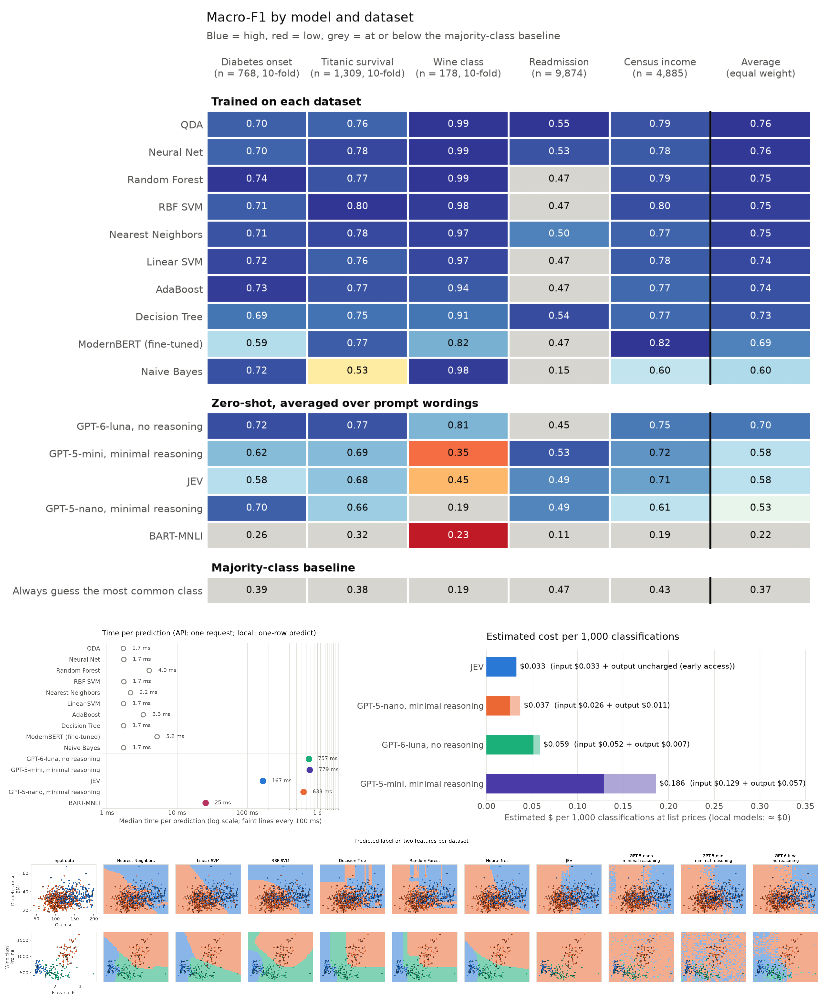

# Benchmarking JEV against traditional ML classifiers

How well does the latest JEV model do against classical ML classifier models, and some other transformer based models that have been released in the past?

I didn't do too much fine-tuning/hyperparameter search for most of these, and you can argue that not every one of them is fully optimized. The point was to see how far we could get with "off the shelf" library sklearn models and by
calling each zero-shot model the way its own documentation shows.

**This entire repo exists because I got nerd-sniped by some LinkedIn post. I heavily used Codex and Claude here. This is not a research quality code base, only for learning.**

This compares two kinds of classifiers on five datasets. Trained models learn from labeled rows.
They are the models from scikit-learn's
[classifier comparison example](https://scikit-learn.org/stable/auto_examples/classification/plot_classifier_comparison.html)
at library defaults, plus a fine-tuned ModernBERT. Zero-shot models see no training data.
They are TypeSafe's JEV, OpenAI's GPT-5-nano, GPT-5-mini and GPT-6-luna, and BART-MNLI.
Every model is scored on the same test rows, next to a majority-class baseline that always
guesses the most common class.



## Results

Trained models score highest when labeled data exists. The best, QDA, averages 0.76
macro-F1 over the five datasets. Fine-tuned ModernBERT averages 0.69. It is the best model
on census income (0.82) but no better than the baseline on readmission.

Among zero-shot models, averaged over the three prompt variants, GPT-6-luna scores 0.70.
GPT-5-mini and JEV tie at 0.58, and GPT-5-nano scores 0.53. JEV is the fastest and cheapest API
model, at about 168 ms and $0.033 per 1,000 predictions. The OpenAI models take 0.6 to 0.8 seconds
per prediction and cost $0.037 to $0.19 per 1,000.
BART-MNLI averages 0.22, below the baseline's 0.37.

Readmission is hard for every model. Eight of the fifteen models do no better than always
guessing "not readmitted".

Keep three limits in mind. The datasets are public, so the API models may have seen them
during pretraining. API answers change a little between runs, which matters most on the
small datasets. The ModernBERT recipe was changed once after its first results, as
described below.

## Run

Create a `.env` file with these keys.

```bash
TYPESAFE_AI_KEY=
OPEN_AI_KEY=
```

```bash
uv run python compare.py
uv run python boundaries.py
uv run python figures.py
uv run pytest -q tests
```

`compare.py` runs the benchmark. It writes `results/results.csv`, `predictions.csv` and
`run.json`. `boundaries.py` draws the two-feature mosaic. It makes its own
API calls and uses a 90/10 split for every dataset. `figures.py` draws the charts and
`summary.png` from saved results. The tests check that every zero-shot model gets the same
question, options and row text.

To format code on each commit with Black and Prettier, run `uv run pre-commit install` once.

To run part of the benchmark, edit `DATASETS`, `MODELS` and `VARIANTS` at the top of `compare.py`.
The model groups are `api`, `sklearn`, `bart` and `modernbert`. Each run replaces
`results.csv`, `predictions.csv` and `run.json`. The charts need every model group.

API answers are cached in `results/cache/` by a hash of the request. The cache is part of
this repo, so a rerun reproduces every published API answer without new API calls. A rerun
only pays for requests it has not sent before. ModernBERT needs a GPU. The published run
used an RTX 3090.

## What is compared

| Dataset                                 | Task                                                               | Rows   | Scored rows     |
| --------------------------------------- | ------------------------------------------------------------------ | ------ | --------------- |
| Diabetes onset (UCI Pima)               | Diabetes within five years of the exam                             | 768    | 768 (10-fold)   |
| Titanic                                 | Passenger survived                                                 | 1,309  | 1,309 (10-fold) |
| Wine                                    | Which of three wines                                               | 178    | 178 (10-fold)   |
| Readmission (Diabetes 130-US hospitals) | Readmitted within 30 days (expired and hospice discharges removed) | 99,343 | 9,874 (90/10)   |
| Census income (UCI Adult)               | Income above $50,000                                               | 48,842 | 4,885 (90/10)   |

Here is what the OpenAI models get for the first diabetes row in the `list` variant. The
question and options go in the `instructions` field.

```text
Based on these diagnostic measurements, will this patient develop diabetes within the next five years?
Answer with exactly one of the labels below.
Options:
- diabetic: The patient will develop diabetes within five years
- not_diabetic: The patient will not develop diabetes within five years
```

The row goes in the `input` field.

```text
Diagnostic measurements for an adult female patient, aged 21 or older.
- Number of pregnancies: 6
- Plasma glucose concentration (mg/dL, 2-hour oral glucose tolerance test): 148
- Diastolic blood pressure (mm Hg): 72
- Triceps skin fold thickness (mm): 35
- 2-hour serum insulin (mu U/ml): unknown
- Body mass index: 33.6
- Diabetes pedigree function: 0.627
- Age (years): 50
```

JEV gets the same question, options and row through its own `instructions`, `criteria` and
`state` fields. BART gets the question and row as its premise and each option as a hypothesis.

- **Data.** Four datasets download from [OpenML](https://www.openml.org/) on first run, which needs internet access. Wine ships with scikit-learn.
- **Split.** Datasets under 2,000 rows use stratified 10-fold [cross-validation](https://scikit-learn.org/stable/modules/cross_validation.html) with seed 42. Trained models are fit once per fold, so every row is scored by a model that never trained on it. Zero-shot models answer every row. Larger datasets use one random 90/10 split. Readmission is split by patient, so no test patient appears in training.
- **sklearn.** The comparison example's models without Gaussian process, which is too slow. Library defaults, except seeded randomness, `MLPClassifier(max_iter=1000)`, `kernel="linear"` for Linear SVM, and `QDA(reg_param=0.1)` when a dataset has text columns. The baseline is `DummyClassifier(strategy="most_frequent")`.
- **API models.** Each row is asked as a multiple-choice question. All zero-shot models get the same question, options and row (`compare.zero_shot_task`, checked by `tests/`). Each model's adapter delivers them through that API's own inputs. JEV gets the question, options and row in separate fields. OpenAI gets the question and options as `instructions` and the row as text `input`, with a JSON row written as text. JEV returns a label and probabilities. The OpenAI models return only a label. They run at the lowest reasoning effort each family allows, `minimal` for GPT-5 and `none` for GPT-6.
- **Prompt variants.** Zero-shot scores depend on wording, so each zero-shot model answers every row three times with three prompts. `list` asks the full question and puts one feature per line. `short` asks a short question and puts all features on one line. `structured` frames the task as a record review and writes the row as JSON text. The facts, the options and everything else stay the same. Each zero-shot score is the mean of the three. The per-variant scores are in `results.csv`. Trained models do not use a question, so they have no variants.
- **BART-MNLI.** The Hugging Face zero-shot pipeline ([model card](https://huggingface.co/facebook/bart-large-mnli)). The question and row text are the premise. Each option is a hypothesis.
- **ModernBERT.** `answerdotai/ModernBERT-base` fine-tuned on the row text with the settings from the authors' [GLUE notebook](https://github.com/AnswerDotAI/ModernBERT/blob/main/examples/finetune_modernbert_on_glue.ipynb). It keeps the epoch with the lowest validation loss. The validation set is 10% of the training rows, or of the training patients for readmission. Training stops early and is capped at 10 epochs, as in the [ModernBERT paper](https://arxiv.org/abs/2412.13663) (Appendix E.1). With the notebook's plain 2 epochs it predicted one class on diabetes, wine and readmission (macro-F1 0.39, 0.19 and 0.47 on the 90/10 split). So the recipe was changed once, to the documented one, and not tuned further. The sklearn models get no validation step.
- **Versions.** `jev-1.13.0`, `gpt-5-nano-2025-08-07`, `gpt-5-mini-2025-08-07` and `gpt-6-luna`.
- **Metrics.** Accuracy, macro precision, recall and F1, ROC-AUC, log-loss, MCC, training time and time per prediction. OpenAI models have no ROC-AUC or log-loss. SVMs have ROC-AUC from decision scores but no log-loss. Time per prediction is the median for one API request or one local row. API requests are spaced to stay under each API's rate limit, and retries do not count toward the time. For trained models it is averaged over folds. The chart shows the median across datasets. Cost comes from token counts and the prices in `figures.py`.
- **Machine.** One desktop with an AMD Ryzen 9 9900X and an NVIDIA RTX 3090. API times were measured from it.
- **Runs.** The API models and BART come from one run of the current code. The sklearn models, the baseline and ModernBERT come from earlier runs of the same code, whose paths have not changed since. `results/run.json` lists both under `merged_from`.
